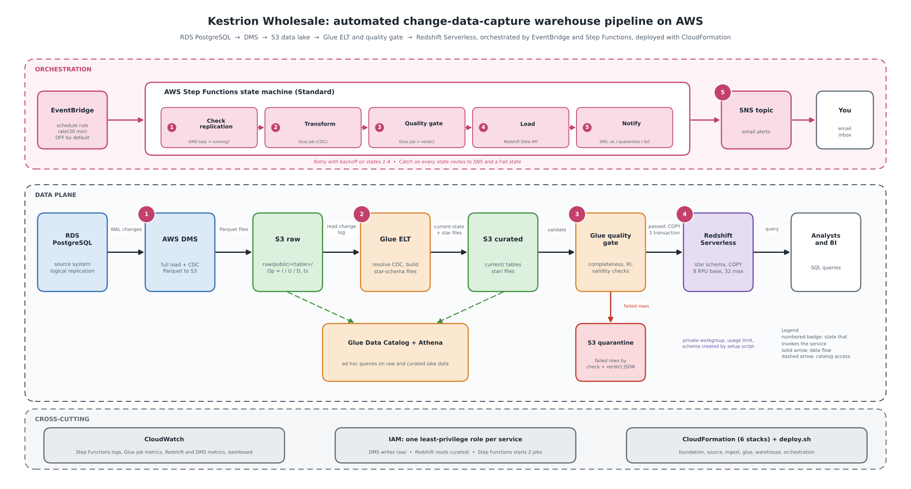
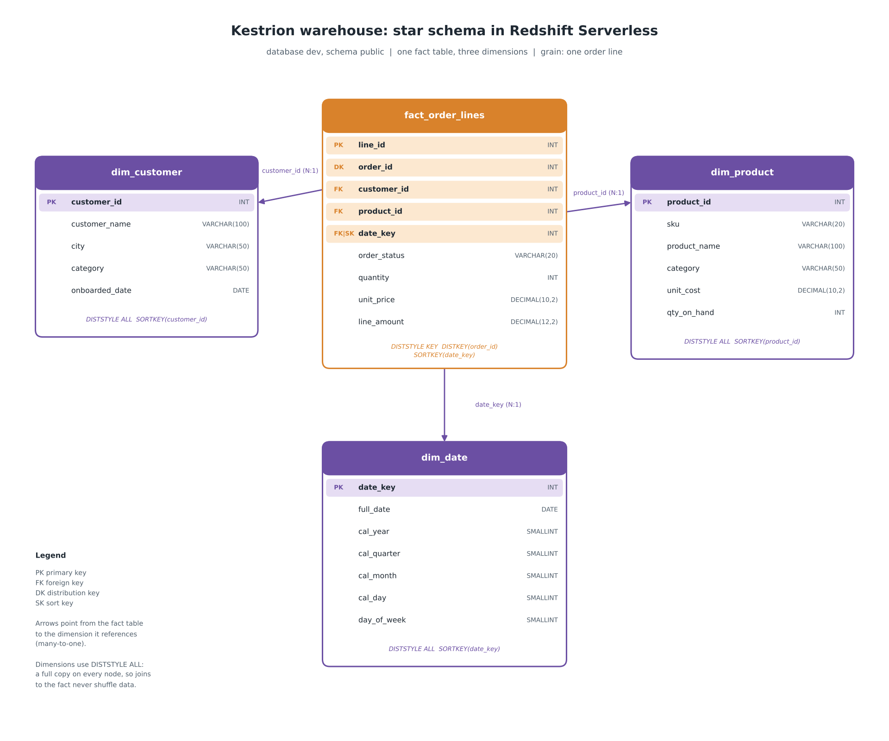

# Kestrion Wholesale: CDC Warehouse Pipeline on AWS

An automated change-data-capture (CDC) pipeline for a fictional wholesale distributor. Every insert, update and delete in the operational order database is replicated to an S3 data lake, resolved into current-state tables, checked by a data-quality gate, and loaded into a Redshift Serverless star schema. The whole chain runs on a schedule, retries transient failures, quarantines bad data, and reports by email. Everything is defined as CloudFormation and deploys with one command.

Built for CCGC 5506 (Humber College), Mid-Term Project 5.

```
RDS PostgreSQL --DMS--> S3 raw --Glue ELT--> S3 curated --Glue quality gate--> Redshift Serverless
                                                  |                                  ^
                                                  +--> S3 quarantine + SNS (on failure)

EventBridge (every 30 min) -> Step Functions:
  CheckReplication -> Transform -> QualityGate -> ReadVerdict -> [pass] LoadRedshift -> SNS
                                                              \-> [fail] Quarantine notice -> SNS
```



## Contents

1. [How it works](#how-it-works)
2. [Repository layout](#repository-layout)
3. [Prerequisites](#prerequisites)
4. [Deploy](#deploy)
5. [Verify the pipeline](#verify-the-pipeline)
6. [Query the warehouse](#query-the-warehouse)
7. [Day-to-day operation](#day-to-day-operation)
8. [Tear down](#tear-down)
9. [Configuration reference](#configuration-reference)
10. [Design notes](#design-notes)
11. [Cost](#cost)
12. [Troubleshooting](#troubleshooting)
13. [Security notes](#security-notes)

## How it works

| Stage | Service | What happens |
|---|---|---|
| Source | RDS PostgreSQL 16 | Four tables (`customers`, `inventory`, `orders`, `order_lines`), seeded with 8, 120, 1,500 and 4,480 rows. A change generator applies inserts, updates and deletes. |
| Capture | AWS DMS | Full load, then ongoing changes read from the write-ahead log (`rds.logical_replication = 1`). |
| Landing | S3 `raw/public/<table>/` | Parquet files with an `Op` column (I, U, D) and a commit timestamp `ts`. |
| Resolve | Glue Spark (`cdc_transform.py`) | Keeps the newest event per primary key (a delete wins ties) and drops deleted keys. Writes `curated/current/` and the star files in `curated/star/`. |
| Gate | Glue Python (`dq_gate.py`) | Completeness, uniqueness and referential-integrity checks. Never fails on bad data: writes `dq/results/<run>.json` and `quarantine/<run>/<check>/`. |
| Load | Redshift Serverless | One Data API batch: `DELETE` + `COPY` for the four tables in a single transaction. |
| Orchestrate | Step Functions + EventBridge | Retry with backoff on the first four states, Catch on every task, SNS email for success, quarantine or failure. |
| Define | CloudFormation (6 stacks) | `deploy.sh` runs them in order and handles the steps CloudFormation cannot. |

Star schema (database `dev`, schema `public`):

| Table | Keys |
|---|---|
| `fact_order_lines` (grain: one order line) | `DISTKEY(order_id)`, `SORTKEY(date_key)` |
| `dim_customer`, `dim_product`, `dim_date` | `DISTSTYLE ALL` |



## Repository layout

| Path | Purpose |
|---|---|
| `iac/01-foundation.yaml` | S3 data bucket, SNS topic, all IAM roles (least privilege) |
| `iac/02-source.yaml` | RDS PostgreSQL (logical replication on), security groups |
| `iac/03-ingest.yaml` | DMS replication instance, endpoints, full-load + CDC task |
| `iac/04-glue.yaml` | Glue databases, raw tables, curated crawler, transform and quality-gate jobs |
| `iac/05-warehouse.yaml` | Redshift Serverless namespace and workgroup, admin secret |
| `iac/06-orchestration.yaml` | State machine, EventBridge rule, execution log group |
| `iac/iam/pipeline-policies.json` | Reviewable IAM design (trust and permissions for all five roles), generated from `01-foundation.yaml` |
| `iac/deploy.sh` | `deploy`, `smoke`, `status`, `teardown` |
| `glue/` | `cdc_transform.py`, `dq_gate.py` |
| `stepfunctions/pipeline.asl.json` | State machine definition (placeholders filled by CloudFormation) |
| `sql/` | `redshift_ddl.sql` (star schema), `grants.sql` |
| `scripts/` | `seed_source.sh`, `setup_warehouse.py`, `export_iam_policies.py` |
| `source/` | `schema.sql`, seed CSVs, `cdc_change_generator.py` |
| `docs/` | Diagrams and the technical report |

## Prerequisites

**Account**
- An AWS account where you can create IAM roles, region `us-east-1` by default (set `AWS_DEFAULT_REGION` to change it).
- A default VPC, or your own (`VPC_ID` and `SUBNET_IDS`). Redshift Serverless needs at least two subnets in two Availability Zones, each with three or more free IP addresses.
- Costs apply while the stack runs. See [Cost](#cost).

**Tools** (AWS CloudShell has most of them already)
- AWS CLI v2, configured (`aws sts get-caller-identity` must work)
- `psql` (PostgreSQL client). CloudShell does not ship it: `sudo dnf install -y postgresql15`
- `python3` with `boto3` (`pip install boto3`), and `curl`
- Bash

**Learner Lab note.** The stacks create their own IAM roles. The AWS Academy Learner Lab blocks role creation and offers only its fixed `LabRole`, so these templates cannot be deployed there unchanged. `iac/iam/pipeline-policies.json` documents the least-privilege design the roles implement.

## Deploy

### 1. Get the code

```bash
git clone <repository-url> kestrion-iac
cd kestrion-iac
```

### 2. Set three required variables

Export them in your shell. Never commit them.

```bash
export ALERT_EMAIL=you@example.com            # where pipeline emails go
export DB_PASSWORD='Kestrion2026db'           # source DB master password: letters and digits, 8+ characters
export REDSHIFT_PASSWORD='Kestrion2026Dw'     # warehouse admin password: 8-64 letters/digits, with upper, lower and a digit
```

Optional settings (see the [reference](#configuration-reference)): `PROJECT`, `AWS_DEFAULT_REGION`, `VPC_ID`, `SUBNET_IDS`, `MY_IP_CIDR`, `SCHEDULE_STATE`.

### 3. Deploy everything

```bash
iac/deploy.sh deploy
```

It takes about 25 to 40 minutes, mostly RDS, DMS and Redshift. The script prints the network it found (VPC, subnets, your public IP) and then runs these steps in order:

| # | Step | Notes |
|---|---|---|
| 1 | Create the account-level `dms-vpc-role` if missing | Needed once per account; teardown never removes it |
| 2 | Deploy `foundation` | Bucket, SNS topic, IAM roles |
| 3 | Upload Glue scripts and the state machine definition to `s3://<bucket>/scripts/` | |
| 4 | Deploy `source` | RDS PostgreSQL with logical replication |
| 5 | Seed the source database | Checks 8 / 120 / 1,500 / 4,480 rows |
| 6 | Deploy `ingest` | DMS instance, endpoints, task |
| 7 | Start the DMS task and wait for the full load | CloudFormation cannot start tasks |
| 8 | Deploy `glue` | Jobs, catalog tables, crawler |
| 9 | Deploy `warehouse` | Redshift Serverless |
| 10 | Create the Redshift tables and grants | `scripts/setup_warehouse.py` |
| 11 | Deploy `orchestration` | State machine and schedule rule (disabled by default) |

When it finishes it prints the next steps. If something fails, find the cause in [Troubleshooting](#troubleshooting). A stack that rolled back must be deleted before you rerun.

### 4. Confirm the email subscription

SNS sends a confirmation message to `ALERT_EMAIL`. Click the link in it. Nothing is delivered until you do.

### 5. Run one execution end to end

```bash
iac/deploy.sh smoke
```

It starts the state machine and prints its status until it finishes. `Pipeline run succeeded` means the chain works from the CDC files in S3 through to the Redshift tables. You also receive a success email.

### 6. Generate change traffic

```bash
DB_HOST=$(aws cloudformation describe-stacks --stack-name kestrion-iac-source \
  --query "Stacks[0].Outputs[?OutputKey=='DbEndpoint'].OutputValue" --output text)

python3 source/cdc_change_generator.py --host "$DB_HOST" --user postgres \
  --password "$DB_PASSWORD" --database kestriondb --engine postgres --duration-minutes 15
```

Then run `iac/deploy.sh smoke` again and compare results (see [Verify](#verify-the-pipeline)).

### 7. Schedule (optional)

The EventBridge rule is deployed **disabled** so an idle environment costs nothing. Enable it only while demonstrating:

```bash
aws events enable-rule  --name kestrion-iac-pipeline-schedule   # runs every 30 minutes
aws events disable-rule --name kestrion-iac-pipeline-schedule
```

To deploy it enabled, set `SCHEDULE_STATE=ENABLED` before `deploy`.

## Verify the pipeline

```bash
iac/deploy.sh status                                   # stack states and key outputs
BUCKET=kestrion-iac-$(aws sts get-caller-identity --query Account --output text)-${AWS_DEFAULT_REGION:-us-east-1}

aws s3 ls s3://$BUCKET/raw/public/ --recursive | head    # CDC files from DMS
aws s3 ls s3://$BUCKET/curated/star/ --recursive | head  # star files from Glue
aws s3 ls s3://$BUCKET/dq/results/                       # one verdict per run
```

| Check | Where to look | Expected |
|---|---|---|
| Full load | `raw/public/<table>/LOAD*.parquet` | A file per table |
| Captured change | `raw/public/<table>/<date>/` after running the generator | New files with `Op` I, U or D |
| Current state | Redshift row counts | Inserts added, updates applied, deletes absent |
| Orchestration | Step Functions console, latest execution | `Succeeded`, every state green |
| Quality gate | `dq/results/<execution>.json` | `"passed": true` |

### See the failure path

The source database enforces its foreign keys, so an orphan row has to be created on purpose. Simulate a source that does not enforce them (psql to the source database):

```sql
ALTER TABLE order_lines DROP CONSTRAINT order_lines_order_id_fkey;
INSERT INTO order_lines (line_id, order_id, product_id, quantity, unit_price)
VALUES (999999, 999999, 1, 1, 10.00);      -- order 999999 does not exist
```

Wait about a minute for DMS to capture it, then run `iac/deploy.sh smoke`. The gate fails its referential-integrity check, the offending row appears under `quarantine/<execution>/`, Redshift is not loaded, and an email lists the failed check. The execution then ends in the `FailQuality` state by design, so `smoke` reports `execution ended as FAILED`; open the execution in the Step Functions console to see the quarantine branch.

Restore the source afterwards:

```sql
DELETE FROM order_lines WHERE line_id = 999999;
ALTER TABLE order_lines ADD CONSTRAINT order_lines_order_id_fkey
  FOREIGN KEY (order_id) REFERENCES orders(order_id);
```

## Query the warehouse

Open **Redshift Query Editor v2**, connect to workgroup `kestrion-iac-wg`, database `dev`, user `admin` and your `REDSHIFT_PASSWORD` (or choose "AWS Secrets Manager" and pick the stack's admin secret). Tables are in schema `public`.

```sql
SELECT d.cal_year, d.cal_month,
       COUNT(DISTINCT f.order_id) AS orders,
       SUM(f.line_amount)         AS revenue
FROM fact_order_lines f
JOIN dim_date d ON d.date_key = f.date_key
GROUP BY d.cal_year, d.cal_month
ORDER BY d.cal_year, d.cal_month;
```

More queries (top customers, best-selling products, margin by category, low-stock risk) are in the technical report.

## Day-to-day operation

| Task | Command |
|---|---|
| Stack states and outputs | `iac/deploy.sh status` |
| One on-demand run | `iac/deploy.sh smoke` |
| Start or stop the schedule | `aws events enable-rule` / `disable-rule --name kestrion-iac-pipeline-schedule` |
| Check the DMS task | `aws dms describe-replication-tasks --query "ReplicationTasks[].[ReplicationTaskIdentifier,Status,LastFailureMessage]" --output text` |
| Regenerate the IAM JSON | `python3 scripts/export_iam_policies.py` (`--check` reports drift) |

## Tear down

```bash
iac/deploy.sh teardown
```

Stops the DMS task, empties the data bucket, and deletes the six stacks in reverse order. It prints the elapsed time. Only the account-level `dms-vpc-role` remains. Teardown and redeploy (`iac/deploy.sh deploy`) is the reproducibility test.

Do this when you finish. An unused replication slot makes PostgreSQL keep its log files, and a running DMS instance, RDS instance and Redshift workgroup all bill.

## Configuration reference

**Environment variables for `iac/deploy.sh`**

| Variable | Required | Default | Meaning |
|---|---|---|---|
| `ALERT_EMAIL` | yes | | Address subscribed to the SNS topic |
| `DB_PASSWORD` | yes | | Source database master password (letters and digits, 8+) |
| `REDSHIFT_PASSWORD` | yes | | Warehouse admin password (8-64 letters/digits with upper, lower and a digit) |
| `PROJECT` | no | `kestrion-iac` | Prefix for stacks and resources |
| `AWS_DEFAULT_REGION` | no | `us-east-1` | Region |
| `DB_NAME` | no | `kestriondb` | Source database name |
| `RS_DB` | no | `dev` | Redshift database |
| `VPC_ID`, `SUBNET_IDS` | no | default VPC and its subnets | Network for RDS, DMS and Redshift (`SUBNET_IDS` comma separated) |
| `MY_IP_CIDR` | no | your current public IP `/32` | Address allowed to reach the source database |
| `SCHEDULE_STATE` | no | `DISABLED` | `ENABLED` to start the 30-minute schedule on deploy |
| `FORCE` | no | | `1` to skip the confirmation prompt on `teardown` |

**Template parameters worth knowing**

| Parameter | Stack | Default | Notes |
|---|---|---|---|
| `ReplicationInstanceClass` | `03-ingest.yaml` | `dms.t3.micro` | Change the default if your account rejects it |
| `BaseCapacity` / `MaxCapacity` | `05-warehouse.yaml` | 8 / 32 RPU | Redshift cost levers |
| `DatabaseName` | `05-warehouse.yaml` | `dev` | Redshift database name |

## Design notes

- **Data failures versus infrastructure failures.** The quality gate never fails because of bad data. It writes a verdict, and the state machine branches on it. Glue and Redshift steps retry transient errors; every task has a Catch that routes to a failure email that includes the real error.
- **CDC resolution.** Newest event per primary key by `ts`; on a tie a delete wins (the generator updates and deletes an order in the same millisecond). Current state is recomputed from the full change log each run: simple and correct at this size. Production alternatives are an incremental merge or Iceberg tables.
- **Atomic load.** `DELETE` + `COPY` for all four tables run in one Data API batch. `TRUNCATE` is avoided because it commits implicitly.
- **Replication slot.** The DMS source endpoint pins the slot name `dms_kestrion`. A pinned name means the slot must already exist when the task starts. See [Troubleshooting](#troubleshooting) if the task fails with "Slot does not exist".
- **Least privilege.** One role per service: DMS writes only `raw/`, Redshift reads only `curated/`, the state machine starts the two Glue jobs, reads `dq/results/` and publishes to one topic, and EventBridge starts one state machine. The Glue role covers the single data bucket. The warehouse is private, and the source accepts connections only from the DMS security group and the operator IP.
- **Lakehouse alternative.** Serving the star schema from Athena (CTAS or Iceberg) instead of Redshift is cheaper at this data size. It is evaluated in the technical report; Redshift is kept because the course brief requires it.

## Cost

Approximate us-east-1 list prices; check the current pricing pages.

| Resource | Behavior |
|---|---|
| Redshift Serverless | Billed per RPU-hour only while active (base 8, maximum 32, daily usage limit set by `setup_warehouse.py`). About $8 a day with 2.8 active hours. |
| RDS db.t3.micro, DMS replication instance | Hourly while the stacks exist |
| Glue, Step Functions, Athena, S3 | Per use; pennies at this size |
| EventBridge schedule | Disabled by default |

Run `iac/deploy.sh teardown` when you are done.

## Troubleshooting

| Symptom | Cause and fix |
|---|---|
| `deploy` stops with a password error on the source stack | `DB_PASSWORD` must be letters and digits only, 8 or more |
| Warehouse stack rejects the password | `REDSHIFT_PASSWORD` needs upper, lower and a digit, letters and digits only |
| Seed script cannot connect | Your IP changed. Rerun with `MY_IP_CIDR=<ip>/32`, or update the security group rule |
| `psql: command not found` | Install the client: `sudo dnf install -y postgresql15` (CloudShell) |
| Source stack fails with "Cannot find version 16" | Set a concrete minor version in `iac/02-source.yaml`. List them: `aws rds describe-db-engine-versions --engine postgres --query "DBEngineVersions[?starts_with(EngineVersion,'16')].EngineVersion"` |
| Ingest stack fails with `Invalid ReplicationInstance class` | The account rejects `dms.t3.micro`. List allowed classes: `aws dms describe-orderable-replication-instances --query "OrderableReplicationInstances[].ReplicationInstanceClass" --output text`. Set a valid class as the default of `ReplicationInstanceClass` in `iac/03-ingest.yaml`, delete the failed stack, redeploy |
| A stack is in `ROLLBACK_COMPLETE` or `REVIEW_IN_PROGRESS` | It cannot be updated. `aws cloudformation delete-stack --stack-name <stack>`, wait, then rerun `deploy` |
| DMS task `failed`, "Slot does not exist" | Create the pinned slot, then reload: `SELECT pg_create_logical_replication_slot('dms_kestrion','test_decoding');` then `aws dms start-replication-task --replication-task-arn <arn> --start-replication-task-type reload-target`. If a stale inactive slot exists, drop it first with `pg_drop_replication_slot` |
| DMS task `failed`, other messages | DMS console, task, "Last failure message". `SHOW wal_level;` must say `logical`; if it says `replica`, reboot the instance: `aws rds reboot-db-instance --db-instance-identifier kestrion-iac-source` |
| Warehouse stack fails with subnets | Needs two or more subnets in two Availability Zones, each with 3+ free IPs. Pass `SUBNET_IDS=subnet-a,subnet-b,...` |
| Warehouse stack fails with `ThrottlingException` | Temporary API limit. Delete the failed stack, delete any leftover `kestrion-iac-ns` namespace and `kestrion-iac-wg` workgroup (workgroup first), wait a few minutes, rerun |
| Changeset fails with `AWS::EarlyValidation::ResourceExistenceCheck` | A resource with the template's name already exists outside the stack, usually a leftover namespace or workgroup from a failed run. Delete it, then rerun |
| Smoke test fails at the Redshift load | As admin: `SELECT * FROM sys_load_error_detail LIMIT 5;` and `SELECT * FROM sys_query_history WHERE status='failed' ORDER BY start_time DESC LIMIT 5;`. Rerun `scripts/setup_warehouse.py` if grants are missing |
| "permission denied for relation" on the load | The state machine's database user (`IAMR:<role name>`) lacks grants on schema `public`. Rerun `scripts/setup_warehouse.py` |
| Stack delete fails on the bucket | Empty it first: `aws s3 rm s3://<bucket> --recursive` |
| `iac/iam/pipeline-policies.json` differs from the template | `python3 scripts/export_iam_policies.py` regenerates it |

## Security notes

- Passwords are exported as environment variables and never stored in the repository. `.gitignore` excludes `.env`, key files and credentials.
- The Redshift admin credentials are generated into AWS Secrets Manager by the warehouse stack.
- The bucket policy denies non-TLS access, the source requires SSL, and the warehouse is not publicly accessible.
- All data is synthetic. Do not load real personal data.

## Author

Germain Tegomo Ngoune, CCGC 5506, Humber College, October 2026.
